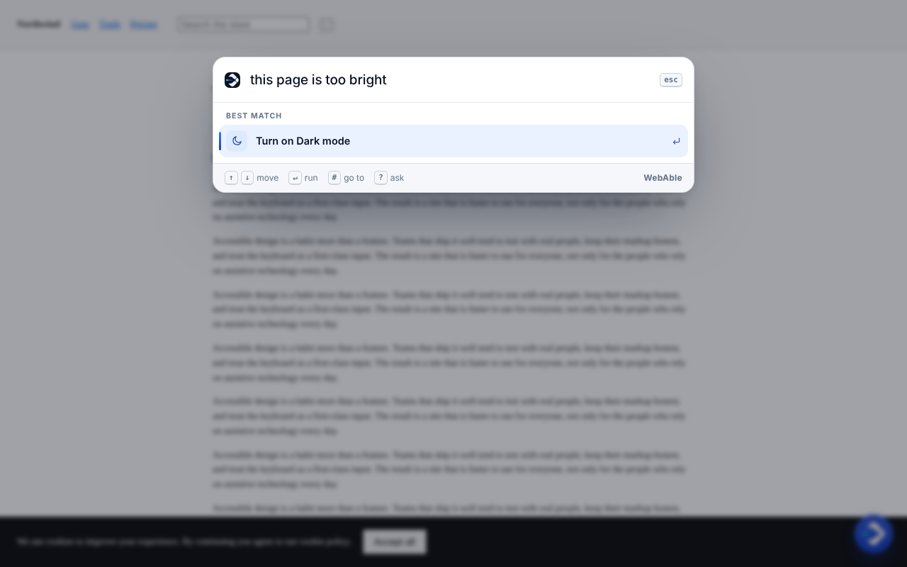
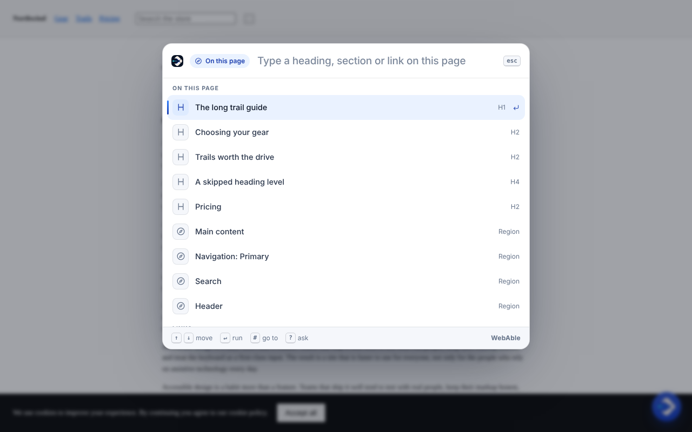
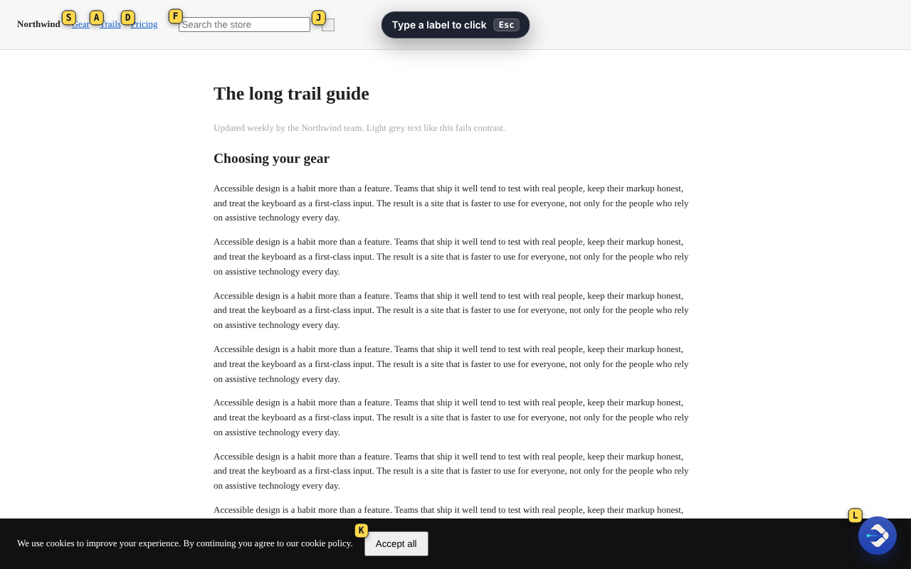
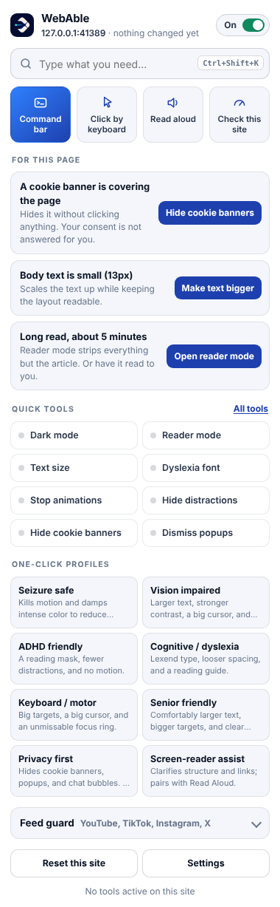
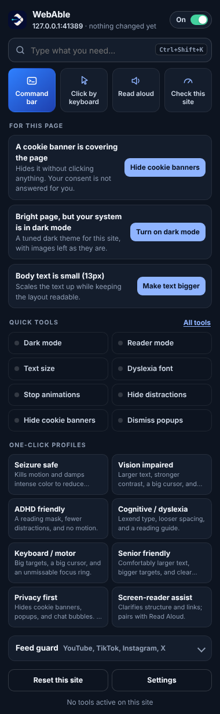
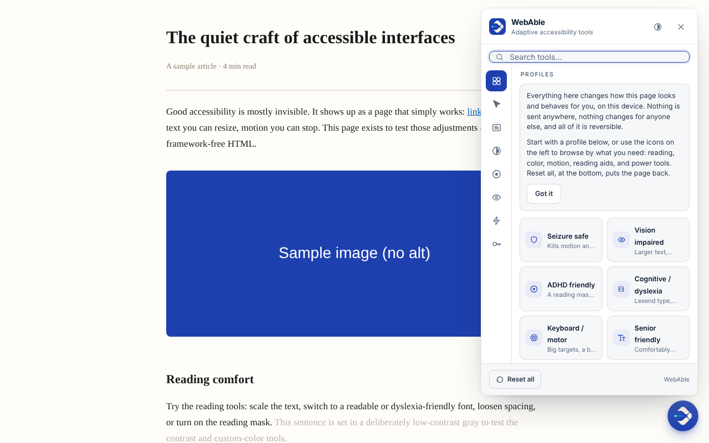
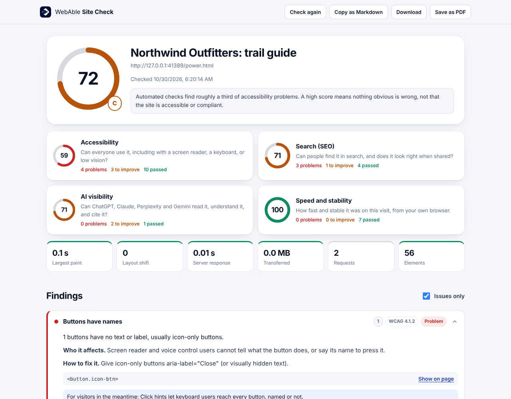

<div align="center">


# WebAble

### The web, adapted to you.

Type what you need in plain words. Click anything without a mouse. Get the
page read to you, cleaned up, enlarged, darkened, or checked, on every site you
visit. Free, open source, and private by default.

[](LICENSE)


**[Install](#install-in-a-minute)** · [What it does](#what-it-does) · [Shortcuts](#keyboard-shortcuts) · [Privacy](#privacy) · [For site owners](#for-site-owners) · [Build from source](#build-from-source) · [webable.cc](https://webable.cc)



</div>

---

## Why

Every website is built one way, for everybody. That works until the text is too
small, the page is too bright, the motion makes you dizzy, the cookie banner
covers the article, or your hands do not want to use a mouse today.

Browsers give you a zoom button. Accessibility overlays sell site owners a
compliance badge. Neither puts **you** in charge of the page in front of you.

WebAble does. It is a browser extension that adapts any website to the person
using it, and it is built around one idea: **you should not need to know what a
tool is called to use it.** Say "too bright" and the page goes dark. Say "I have
dyslexia" and the type, spacing and reading aids change together. Say "go to
pricing" and you are there, with keyboard focus on it. Every change has an Undo.

It started as an accessibility tool and it still is one, first. It also turns
out that what helps someone with low vision or a tremor makes everybody else
faster, so it is built for both.

## Install in a minute

The Chrome Web Store listing is on its way. Until then, it takes about a minute:

1. **[Download this repository as a ZIP](https://github.com/Mvnshi/WebAble-Plugin/archive/refs/heads/main.zip)** and unzip it.
2. Open `chrome://extensions` (Edge: `edge://extensions`).
3. Switch on **Developer mode** (top right).
4. Click **Load unpacked** and choose the **`extension`** folder inside the unzipped download.
5. Pin WebAble from the puzzle-piece menu so it is one click away.

A welcome page opens and asks one question: *what would make the web easier for
you?* Pick what applies; you will see it happen on that page before anything is
saved.

Works in Chrome, Edge, Brave, Arc, Opera, Vivaldi, and other Chromium browsers.
Tagged releases also carry a ready-made ZIP under
[Releases](https://github.com/Mvnshi/WebAble-Plugin/releases).

## What it does

### The command bar: type what you need

Press **Ctrl+Shift+K** (**Cmd+Shift+K** on a Mac) on any site and type.

| You type | WebAble does |
| --- | --- |
| `too bright` · `hurts my eyes` | Turns on dark mode |
| `text 150%` · `bigger text` · `I can't read this` | Sets or steps up the text size |
| `I have dyslexia` · `too much going on` | Applies the dyslexia or ADHD profile |
| `make it stop moving` | Freezes animation and autoplay |
| `read this to me` · `stop reading` | Read aloud with your device's voice |
| `2x` · `play at 1.25` · `louder` | Video speed and volume, for every player on the page |
| `go to pricing` · `#install` | Jumps to that heading, section or link and moves keyboard focus there |
| `search for trail boots` | Types into the site's own search box and submits it |
| `copy a clean link` | Copies the URL with tracking parameters removed |
| `check this site` | Opens Site Check |
| `? who wrote this` | Answers from the page (optional AI) |

The sentence is understood **on your device**: a phrasebook, not a language
model, so it works on day one with no key, no account and no network, in under
a millisecond. A request it does not recognise falls back to fuzzy search over
every tool, profile, heading and link, tolerant of typos and initials (`pip`,
`drak mode`). If you add an AI key, anything still unmatched can become a
question about the page.



### Click anything without a mouse

Press **Alt+Shift+H**. Every link, button and field you can see gets a short
label. Type the label and it is clicked; hold **Shift** to open a link in a new
tab. Two keys to any control, instead of fifty presses of Tab.

**Number mode**, set in Settings, labels everything 1, 2, 3 and lets you type
words to filter ("check" leaves only the controls that say checkout). It is
built for voice control: "type 14" is a command every dictation system already
understands.

Hints skip anything covered by a modal, reach into shadow DOM, and never fire
the site's own keyboard shortcuts underneath.



### Suggestions for the page you are on

Click the toolbar button and WebAble tells you what it noticed **on this page**,
with the one fix for each: a cookie banner over the article, a sign-up wall, a
bright page while your system is set to dark, body text under 14px, text that
fails contrast, a 3,000-word article, video playing on its own. Nothing changes
until you press the button.

<p>

&nbsp;

</p>

### 43 tools and 8 one-click profiles

Everything from the original WebAble, rebuilt on one shared engine:

- **Reading:** reader mode, text size, readable and dyslexia fonts (OpenDyslexic, Lexend, Atkinson), line/letter/word spacing, bionic reading, reading guide, reading mask, focus mode, magnifier, highlight-to-explain, double-click dictionary
- **Colour:** dark mode, invert, high contrast, saturation, colour-blindness filters (assist or simulate), your own colours
- **Motion and focus:** stop animations, mute media, hide images, hide distractions, visible focus ring, big cursor, bigger click targets, pinned tooltips
- **Power tools:** hide cookie banners, dismiss pop-ups, break sign-up walls, unpin sticky bars, expand all, playback speed, volume boost, picture-in-picture, auto-scroll, unlock copy and right-click, force pinch-zoom, fix-this-site element hiding, clean copy
- **Feed guard** for YouTube, TikTok, Instagram and X: hide Shorts, clickbait, sponsored posts and comments, sort the feed into 37 categories, daily limits and focus sessions
- **Profiles:** Seizure safe, Vision impaired, ADHD friendly, Cognitive / dyslexia, Keyboard / motor, Senior friendly, Privacy first, Screen-reader assist

Settings are remembered per site, and you can save a set as your default for
every site. Read aloud uses the voices already on your device. Optional AI
(summaries, plain-language rewrites, alt text, questions about a page, an
on-page guide that points at what to click) uses your own free Google Gemini key
or a WebAble Pro subscription.



### Site Check

One click, any page, a report built **in your own browser** from the page as it
actually rendered. That is the difference from most free checkers, which fetch
the HTML and guess:

- **Accessibility:** colour contrast measured from computed styles, unnamed
  buttons and links, unlabelled fields, alt text, headings, landmarks, zoom
  blocking, WCAG 2.2 target size, focus traps in hidden content, and more
- **Search:** title, description, indexability, canonical, mobile viewport,
  social cards, HTTPS
- **AI visibility:** whether `robots.txt` lets GPTBot, ClaudeBot, PerplexityBot
  and Google-Extended in, `llms.txt`, structured data, quotable content
- **Speed:** LCP, CLS and TTFB from this visit's own performance timeline, page
  weight, element count, third-party scripts

Every finding says **who it affects** and **how to fix it**, has a *Show on page*
button, and exports as Markdown or PDF. It also says plainly that automated
checks find roughly a third of accessibility problems; a high score means
nothing obvious is wrong, not that a site is compliant.



## Keyboard shortcuts

| Keys | What |
| --- | --- |
| **Ctrl+Shift+K** (Mac **Cmd+Shift+K**) | Command bar |
| **Alt+Shift+H** | Click hints |
| **Ctrl+Shift+U** (Mac **Cmd+Shift+U**) | The full panel |
| `#` in the command bar | Go to a heading, section or link |
| `?` in the command bar | Ask about the page |
| **Shift+Enter** on a link result | Open it in a new tab |

Change any of them at `chrome://extensions/shortcuts`. If another extension
already holds a key, the browser leaves it unbound without saying so; WebAble
also listens inside the page so the defaults keep working, and the welcome page
tells you if anything was not bound.

## Who it is for

- **Low vision:** text size that reflows, high contrast, dark mode, magnifier, big cursor, a focus ring you cannot miss
- **Dyslexia and reading difficulty:** Lexend or OpenDyslexic, roomier spacing, reading guide, reader mode, read aloud, plain-language rewrites
- **ADHD and attention:** reader mode, hide distractions, reading mask, focus mode, feed guard, no autoplay
- **Motor and keyboard users:** click hints, bigger targets, visible focus, "go to" navigation that moves focus
- **Voice control users:** number hints, and a command bar that takes sentences
- **Vestibular disorders, migraine, photosensitivity:** stop animations, Seizure safe, dark mode, saturation
- **Older adults:** the Senior friendly profile, and a welcome page that asks in plain words
- **Everyone in a hurry:** two keys to any button, "search for", "2x", clean links, no cookie banners

## Privacy

WebAble runs on your device. There is no account, no analytics and no tracking.
What leaves your browser, and only when you ask for it:

| When | What is sent | To |
| --- | --- | --- |
| You use an AI feature with your own key | The text or images you acted on | Google (Gemini), directly |
| You use an AI feature with WebAble Pro | The same | WebAble's relay, which forwards it to Google and does not store it |
| You double-click a word | That one word | dictionaryapi.dev |
| You run Site Check | A request for that site's own `/robots.txt` and `/llms.txt` | The site you are on |
| You click a link in a Site Check report | The link you clicked (only the deep-scan link includes the page address) | webable.cc or w3.org |

Your AI key is stored only on the device where you typed it and never syncs.
Full details: [PRIVACY.md](PRIVACY.md).

## Honest by design

WebAble changes pages **for you**. It does not claim to make any website
accessible or compliant, does not hand out badges, does not show crawlers
anything different from people, and leaves the page's accessibility tree alone
so screen readers keep working. Cookie banners are hidden, not answered on your
behalf, unless you turn that on. The FTC has fined an overlay vendor a million
dollars for promising otherwise; this project is built on the opposite promise.

## For site owners

**Site Check** shows what is wrong and who it hurts. When you want it fixed in
the site itself, rather than papered over, WebAble offers
[fix plans for custom code, Webflow, Framer, Squarespace, WordPress, Wix and Shopify](https://webable.cc/business#pricing),
human-assisted fix sprints, and a monthly partner for accessibility, SEO, AI
visibility and growth. Every Site Check report links there after the findings,
never before them.

**The widget** gives every visitor to your site the same toolkit, with nothing
to install. One line:

```html
<script src="https://cdn.jsdelivr.net/gh/Mvnshi/WebAble-Plugin@main/dist/widget.js" async></script>
```

The old `dist/webable.js` address keeps working and now serves the same build.
Brand colour, position, tool list and the JavaScript API are in
[EMBED.md](EMBED.md).

## Build from source

You only need this to change the code; the `extension` folder in the repository
is already built.

```bash
npm install
npm run build              # widget into dist/, extension into extension/
npm run dev:ext            # rebuild the extension on every save
npm run check              # types, 431 unit tests, 48 real-browser tests, bundle budget, axe audit, house style
npm run screenshots        # regenerate docs/screenshots from the built extension
npm run package:extension  # a Chrome Web Store ZIP
```

The browser tests drive the built extension in a real Chromium with Playwright
(`npx playwright install chromium` once). CI fails if `extension/` or `dist/`
drift from the source, so what you download is always what the source builds.

```
packages/core       the engine: 43 tools, profiles, storage, read aloud, AI providers. No UI.
packages/ui         the panel, in Preact, mounted in a shadow root
packages/power      command bar, phrasebook, click hints, page insights, Site Check (extension only)
packages/companion  streaming protocol for the on-page guide
apps/extension      the MV3 extension: content script, popup, report, welcome, options
apps/widget         the one-line website widget (65 KB budget, enforced)
extension/          built extension, load this folder unpacked
dist/               built widget, served by jsDelivr
examples/test-site  fixture pages the browser tests and screenshots run against
```

More in [docs/ARCHITECTURE.md](docs/ARCHITECTURE.md).

## Contributing

Bug reports from people who rely on a tool are the most valuable contribution
there is, and you do not need to write code to make one. New phrases for the
command bar are the easiest code contribution: one line in
`packages/power/src/intents.ts` and one line in its test. See
[CONTRIBUTING.md](CONTRIBUTING.md).

## License

[MIT](LICENSE). Third-party code and fonts, and their licences, are listed in
[NOTICE](NOTICE).
